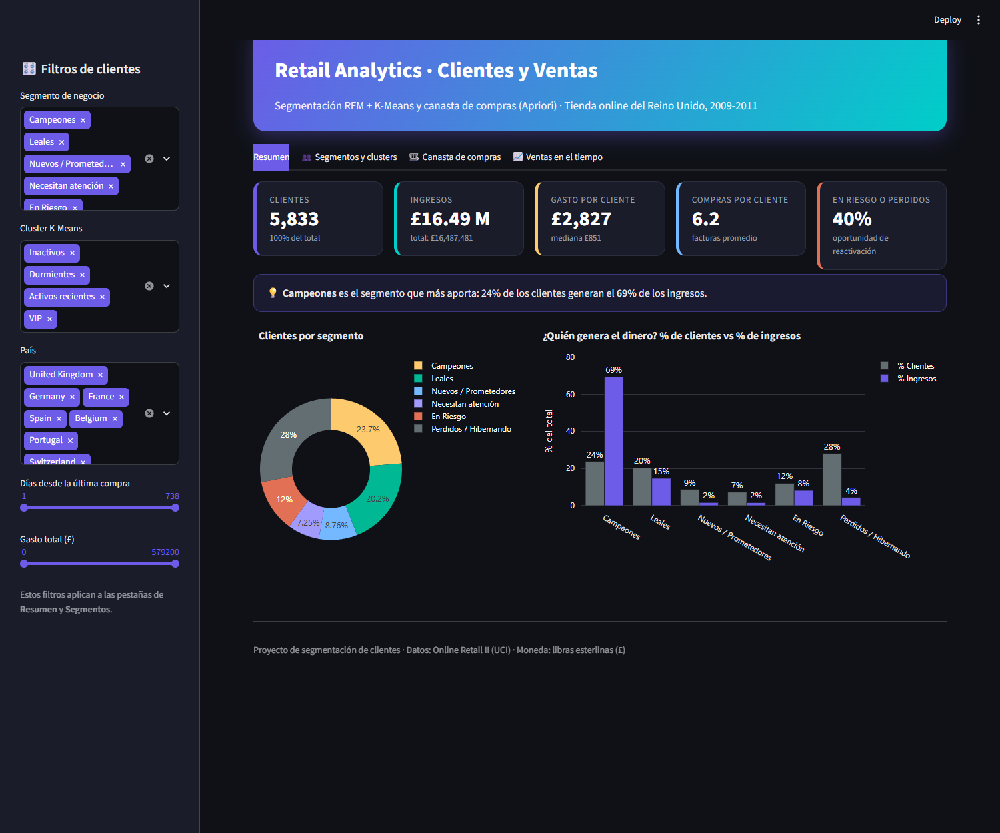
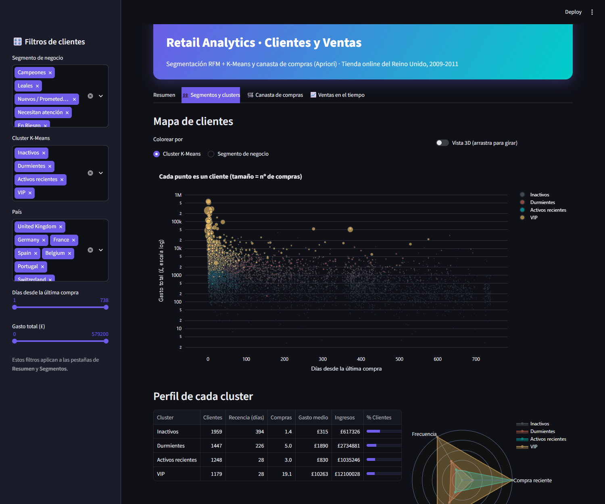
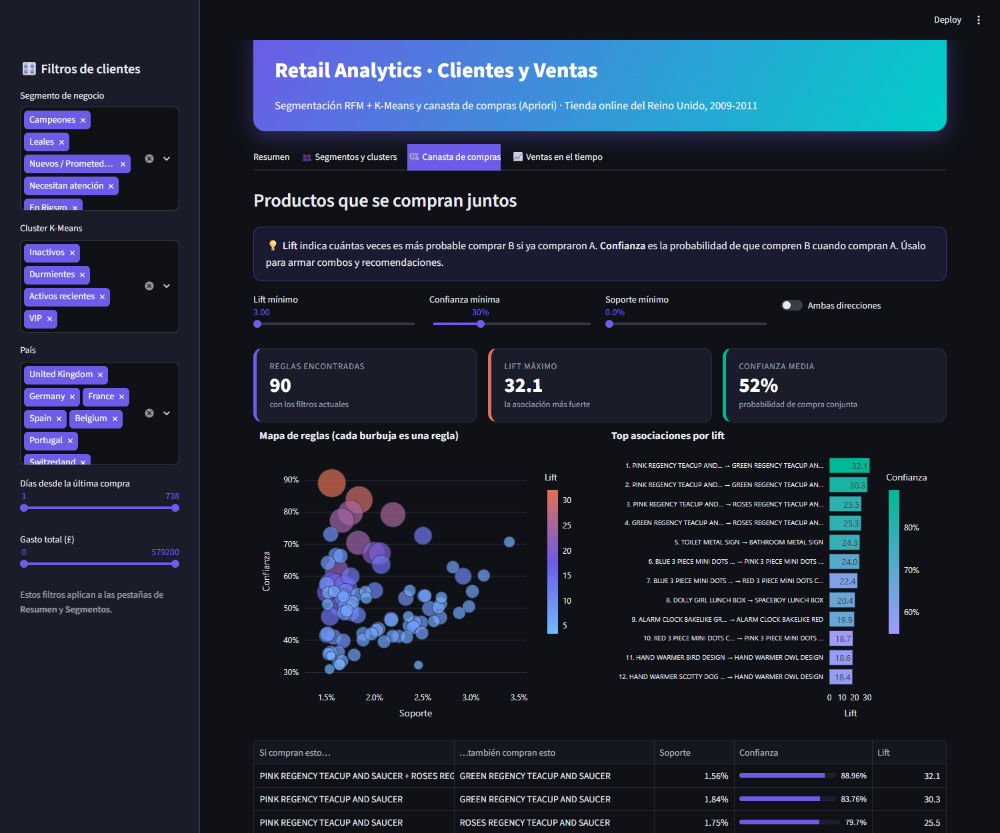

# 📊 E-commerce Customer Intelligence & Cross-Selling

Un análisis *End-to-End* de más de 1 millón de transacciones de retail para segmentar clientes mediante modelos RFM y K-Means, acoplado a un motor de recomendación con el algoritmo Apriori.



<details>
<summary>📸 Ver más capturas (segmentación y canasta de compras)</summary>





</details>

## 🎯 Problema de Negocio
El e-commerce genera un gran volumen de transacciones diarias, pero carecía de visibilidad sobre quiénes son sus clientes más valiosos (VIP), quiénes están a punto de abandonar la marca, y qué productos se compran frecuentemente juntos. Este proyecto busca transformar datos crudos en estrategias accionables para retención y *cross-selling*.

## 📂 Datos
* **Fuente:** Dataset *Online Retail II* (UCI Machine Learning Repository). [Enlace al dataset](https://archive.ics.uci.edu/ml/datasets/Online+Retail+II).
* **Tamaño y Periodo:** +1.06 Millones de registros, cubriendo ventas del 2009 al 2011 en Reino Unido.
* **Limpieza:** Se filtraron valores nulos en `Customer ID` (compras de invitados), códigos que no son productos (envío, ajustes, comisiones), duplicados exactos y cancelaciones (facturas con prefijo 'C'). Además, las compras que fueron devueltas se emparejaron con su cancelación para no inflar el gasto de los clientes. Resultado: un dataset analítico de 769,725 líneas de venta limpias (5,833 clientes). Todo el proceso está en `notebooks/01_EDA_y_limpieza.ipynb`.

## 📈 Hallazgos Clave
* **La Ley de Pareto se cumple:** Un núcleo de **1,385 clientes "Campeones"** (24% de la base) genera cerca del **69%** de los ingresos.
* **Volumen de Abandono:** Existen **1,632 clientes en estado "Perdidos / Hibernando"** (28%), lo que indica fallos históricos en las campañas de fidelización post-compra.
* **Fuerza de Asociación (Market Basket):** El algoritmo Apriori descubrió que los productos `SWEETHEART CERAMIC TRINKET BOX` y `STRAWBERRY CERAMIC TRINKET BOX` tienen un **Lift de 13.1**, y que el trío de tazas `PINK / ROSES / GREEN REGENCY TEACUP AND SAUCER` llega a un **Lift de 32** con 89% de confianza. Es decir, quien compra dos de las tazas casi siempre compra la tercera.

## 💡 Recomendaciones Estratégicas e Impacto
| Segmento | Acción Recomendada | Canal | Objetivo |
| :--- | :--- | :--- | :--- |
| **Campeones** | Programa VIP, acceso anticipado a colecciones exclusivas. | Email / Web | Retención |
| **Leales** | Venta cruzada dinámica usando las reglas de asociación (Apriori). | Checkout Web | Subir Ticket Promedio |
| **En Riesgo** | Descuento agresivo de reactivación urgente o llamada directa. | Email / SMS | Recuperación |
| **Nuevos** | Campaña de bienvenida con incentivo para su segunda compra. | Email | Fidelización |

💰 **Impacto Estimado:** El análisis detectó 701 clientes "En Riesgo" que históricamente gastaron **£1.35 M** pero han dejado de comprar. Si se logra reactivar solo al **10%** de este segmento mediante campañas dirigidas, se estima una recuperación potencial de **~£135,000** en ingresos.

## 🛠️ Metodología
1. **Modelado RFM:** Se calculó Recencia (días desde última compra), Frecuencia (nº facturas) y Monto (gasto histórico) por cliente, con puntajes del 1 al 5 y 6 segmentos de negocio (`notebooks/02_RFM_y_clustering.ipynb`).
2. **Machine Learning No Supervisado:** Se validó la segmentación aplicando **K-Means Clustering**. Usando el Método del Codo y el coeficiente de silueta, se determinó `K=4` como el número óptimo de clusters (Inactivos, Durmientes, Activos recientes y VIP), los cuales coincidieron con las reglas de negocio manuales (tras aplicar estandarización y escala logarítmica).
3. **Análisis de Canasta (Apriori):** Creación de una matriz de canastas por factura para extraer reglas de asociación con *Lift ≥ 3* y confianza ≥ 30% (`notebooks/03_Canasta_de_compras.ipynb`).

## 🚀 Cómo ejecutarlo localmente

### Solo ver el dashboard (rápido)
Los resultados ya vienen incluidos en `data/processed/`, así que no necesitas descargar el dataset:

```bash
git clone https://github.com/eduardobox2/retail-customer-analytics.git
cd retail-customer-analytics
python -m venv .venv
.venv\Scripts\activate        # En Linux/Mac: source .venv/bin/activate
pip install -r requirements.txt
streamlit run dashboard/app.py
```

### Reproducir todo el análisis desde cero
1. Descarga *Online Retail II* desde [UCI](https://archive.ics.uci.edu/ml/datasets/Online+Retail+II) y guárdalo como `data/raw/online_retail_II.xlsx`.
2. Carga el Excel a SQLite (crea `data/retail.db`):
   ```bash
   python scripts/load_data.py
   ```
3. Ejecuta los notebooks en orden desde la carpeta `notebooks/`: `01_EDA_y_limpieza` → `02_RFM_y_clustering` → `03_Canasta_de_compras`. Cada uno regenera los archivos de `data/processed/`.

## 🗂️ Estructura del proyecto
```
├── dashboard/        # App Streamlit (app.py) y estilos (style.css)
├── data/
│   ├── processed/    # Resultados listos para el dashboard (CSV)
│   └── raw/          # Dataset original (no se sube a Git)
├── notebooks/        # 01 Limpieza y EDA · 02 RFM y K-Means · 03 Apriori
├── scripts/          # load_data.py: Excel → SQLite
├── assets/           # Capturas del dashboard
└── requirements.txt
```
